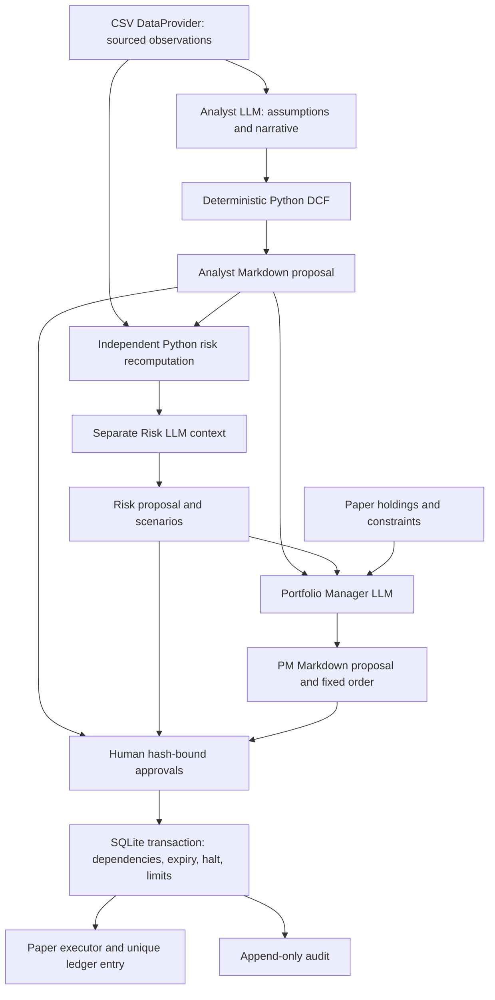

# Multi-Agent Investment Research Workstation

A local, CLI-first research pipeline: an equity analyst proposes assumptions, an adversarial risk manager independently checks valuation, and a portfolio manager stages a constrained paper order. Every stage becomes a Markdown proposal. Humans approve immutable content before any paper fill.

**Research and education tool only; not financial advice. Paper trading only.**

## Install and run

Requires Python 3.11+ and, for real model calls, [Ollama](https://ollama.com/) installed locally. No cloud keys are required. From this repository:

```powershell
python -m venv .venv
.\.venv\Scripts\Activate.ps1
python -m pip install -e ".[dev]"
Copy-Item ws.example.toml ws.toml
ollama pull llama3.1:8b
ollama pull qwen2.5:7b
# If Ollama is not already running:
ollama serve
```

In another terminal with the environment activated, run `ws doctor`. It checks `/api/tags`, reports model digests and prints exact pull commands for missing models. `OLLAMA_HOST` from the environment or `.env` overrides the TOML host. `python -m workstation` is equivalent to `ws` when working from the repository.

### Fully offline quickstart

The included `DEMO` inputs are synthetic, dated 2026-11-01. They are not a real ticker. This PowerShell sequence uses mock models, no server and no internet; installation of dependencies is a one-time prerequisite:

```powershell
$analystId = (ws --mock analyze DEMO | ConvertFrom-Json)[0].id
ws show $analystId
$riskId = (ws --mock review $analystId | ConvertFrom-Json).id
ws show $riskId
$pmId = (ws --mock propose $riskId | ConvertFrom-Json).id
ws show $pmId
# Inspect all three proposals before approving them:
ws approve $analystId
ws approve $riskId
ws approve $pmId
ws execute $pmId
ws status
ws audit
```

For Ollama, omit `--mock` on analyze/review/propose. With the CSV provider these local model calls also work without internet. Each command prints JSON including its new proposal ID. `ws analyze DEMO OTHER` runs independent research jobs within the configured concurrency limit; every ticker must exist in the CSV. Failed tickers are reported and produce a nonzero exit code without undoing completed tickers.

The example fixture eventually becomes stale on purpose. Use newly sourced data, or explicitly set `max_data_age_days = 36500` **only for the synthetic offline exercise**. Tests generate current fixture dates internally. A worked proposal and its supporting reports are in `examples/`; those files are documentation, not executable proposals in your ledger.

### Review controls

```powershell
ws reject PROPOSAL_ID --reason "Margin assumption unsupported"
ws reject PROPOSAL_ID --request-changes --reason "Rework the forecast"
ws approve RISK_ID --override-risk "Human accepts the stated risk for this paper experiment"
ws halt --reason "Pause all paper executions"
```

A risk `reject` or `request_changes` cannot receive ordinary approval. Only the human CLI path with a nonempty override reason can approve that risk content. Then approve the downstream PM proposal. An operator's `ws reject` is final; generate fresh proposals to revise. Every linked proposal must retain its approval through execution.

Senior review is off by default. To opt in, set `senior_approval_enabled = true`, then use `ws approve ID --senior`. It stages a separate senior report and applies its verdict to the target. It cannot review itself or override an unoverridden risk rejection. Human approval requires no running Ollama server. `ws halt` is persistent, blocks all future paper execution in that workspace and has no automatic resume.

All options such as `--root`, `--config` and `--mock` come **before** the subcommand. `ws --root C:\research\experiment --config C:\research\settings.toml status` selects an isolated store. Relative `data_file` paths resolve from `--root`; `.env` resolves beside the config file. `.ws/` holds the SQLite database, `proposals/` holds Markdown. Both are ignored by Git.

Use an unsynced local disk for an active ledger. Do not run the same SQLite store from multiple machines or synchronize it through OneDrive while in use; SQLite transactions protect local processes, not cloud-sync conflicts.

## Architecture



Agent modules live in `workstation/agents/`, each with its own system prompt in `workstation/prompts/`. The provider never shares chat history between agents. Risk uses raw inputs and an independent iterative DCF computation, checks agreement with analyst results, and runs nine sensitivity cells and three stress scenarios. The LLM supplies narrative and assumptions, never arithmetic. An independent implementation catches inconsistencies, not flaws common to the underlying DCF methodology.

## Data and provenance

The shipped CSV provider requires these columns:

```text
ticker,sector,metric,value,unit,currency,source,as_of
```

Each ticker must provide `revenue`, `fcff`, `cash`, `debt`, `shares`, and `price`. Each metric needs its own source and ISO date. Money must use absolute units (`currency`), share count uses `shares`, and price uses `per_share`. All rows must use one currency and one sector per ticker. Use explicit unlevered FCFF; never relabel vendor levered free cash flow as FCFF. Align reporting periods and share bases before importing. Sources and financial interpretations are operator-supplied and must be reviewed.

The data provider interface is pluggable; **there is no live market-data adapter shipped**. Add an implementation of `DataProvider.fetch` returning validated `Financials` to integrate a vendor. Do not weaken input checks to accommodate missing or inconsistent data.

Each fetched observation appears with its source and as-of date. Agent prose must reference named values (`{{data.revenue}}`, `{{calc.fair_value}}`, `{{assumption.wacc}}`); unknown references and literal numerical claims are rejected. Derived values cite the deterministic engine and input date, while forecast values are labelled assumptions. Positive revenue/FCFF/shares, compatible units/currency, terminal growth below WACC and the configured long-run bound are enforced. Terminal value above 75% of enterprise value is flagged.

## Configuration reference

Copy `ws.example.toml` to `ws.toml`. Unknown fields and invalid ranges fail validation. Defaults:

| Setting | Default | Meaning |
| --- | --- | --- |
| `ollama_host` | `http://localhost:11434` | Local Ollama HTTP API; `OLLAMA_HOST` wins |
| `analyst.model`, `pm.model` | `llama3.1:8b` | Local model tags |
| `risk.model`, `senior.model` | `qwen2.5:7b` | Different review family recommended, not required |
| `num_ctx` | `16384` | Sent on every request; conservative input estimate plus output reserve must fit |
| `max_output_tokens` | `1536` | Per-call output cap (`num_predict`) |
| `token_budget` | `100000` | Conservative total input/output reservations per command, including retries |
| `wall_clock_seconds` | `1800` | Whole model command deadline, including queued work |
| `timeout_seconds` | `600` | HTTP request timeout; startup checks capped at 30 seconds |
| `concurrency` | `1` | Whole jobs and model calls per process |
| `temperature`, `seed` | `0.0`, `42` | Recorded reproducibility settings |
| `keep_alive` | `5m` | Ollama model retention hint |
| `retries` | `2` | Extra attempts for malformed schema output |
| `expiry_hours` | `24` | TTL from proposal creation; ancestor TTLs still apply |
| `max_data_age_days` | `120` | Maximum age of any input observation |
| `terminal_growth_bound` | `0.03` | Long-run nominal growth ceiling |
| `data_file` | `examples/financials.csv` | CSV relative to workspace root |
| `initial_cash`, `currency` | `100000`, `USD` | New-store paper cash; existing cash is never reset |
| `max_position_size` | `0.10` | Post-trade position / paper NAV cap |
| `max_sector_exposure` | `0.30` | Post-trade sector / paper NAV cap |
| `cash_floor` | `0.10` | Minimum post-trade cash / paper NAV |
| `senior_approval_enabled` | `false` | Explicit opt-in to weaker automatic approval |
| `DANGEROUS_ENABLE_REAL_EXECUTION` | `false` | Keep off; enabling refuses execution because no broker exists |

Choose a context size the installed model and hardware support. Admission control is deliberately conservative and may reject text that would fit a model-specific tokenizer. The client cannot guarantee that a server honors its requested context limit. Schema output is passed through Ollama's `format` parameter and revalidated with Pydantic. Reasoning blocks are stripped; malformed/unclosed reasoning or truncated output is not accepted. Model digests from `/api/tags` are checked before and after each generation and recorded in frontmatter alongside prompt hashes.

Local model loading can be slow. Ollama's `OLLAMA_NUM_PARALLEL` and `OLLAMA_MAX_LOADED_MODELS` affect throughput; configure these on the Ollama server. Three distinct models may cause repeated load/unload cycles. Start at concurrency one. Parallel CLI processes share the transactional ledger but not a common model-call semaphore.

## Safety model and limits

- Human approval is the default. **Small local models approving other local models provide weak assurance.** Different model families do not establish independence or correctness. Review provenance, assumptions, stress scenarios and trade size yourself.
- Fetched documents and other agent text are untrusted data, serialized as data in separate user messages. System prompts reject instruction-following from that content. Models have no tools, shell or execution credentials. Prompt hygiene and structured outputs do not eliminate prompt injection; deterministic checks and human gates constrain its effects.
- The immutable content hash covers proposal content, action and parent hashes; the full on-disk Markdown hash catches edits to frontmatter, prose or whitespace. Changes invalidate approvals and are logged. Generate new proposals after revisions. Expiry and freshness are checked at read/approval/execution, not by a background daemon.
- Execution checks the full approved dependency chain, stale data, kill switch, order limits and current portfolio in one transaction. The unique ledger key prevents a duplicate fill even across processes. The audit is append-only through the application and records actors, timestamps, hashes and reasons.
- This is a single-user local trust model. The operator controls the code and database; it is not an authenticated multi-user trading system or a cryptographically immutable audit service. SQLite and Markdown can diverge after a crash; the next operation fails closed.
- All fills are hypothetical snapshot-price fills. Last paper fill prices mark existing holdings. No fees, slippage, live marks, FX, shorts, tax lots or corporate actions. Paper performance is not evidence of executable real-world returns. CSV data quality and qualitative prose remain human responsibilities.
- There is no broker implementation. Enabling the loudly named real-execution flag refuses to run. No live trade path has been tested or provided.

## Development and validation

```powershell
python -m pytest -q
ruff check .
ruff format --check .
```

Tests require no Ollama server, internet or keys. HTTP tests use `httpx.MockTransport`; workflow tests use deterministic fixtures and `MockProvider`. Coverage includes DCF sanity rules, independent arithmetic, provenance rejection, model request options, retry/budget behavior, hash invalidation, lifecycle transitions, senior self-approval, risk overrides, expiry, concurrency, idempotency, the kill switch, limits and CLI end-to-end execution.

See `DECISIONS.md` for design tradeoffs and extension boundaries. The adversarial pattern was informed by [ai-berkshire](https://github.com/xbtlin/ai-berkshire) without copied code or a runtime dependency. Provider behavior follows the official [Ollama chat](https://docs.ollama.com/api/chat) and [tags](https://docs.ollama.com/api/tags) APIs.
